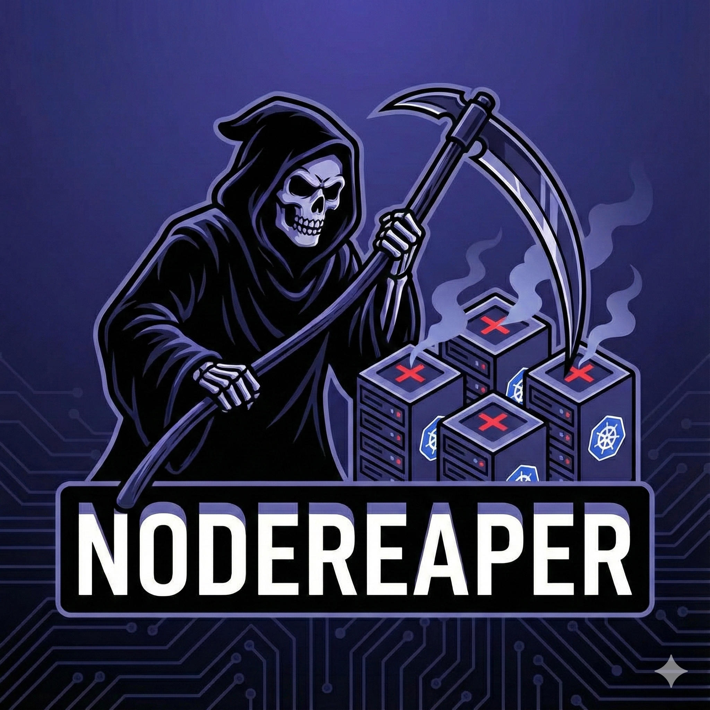

# NodeReaper

<div align="center">
  

  *Automatically harvests empty and unhealthy nodes when autoscalers fail to scale down*
</div>

<div align="center">

[](https://github.com/sdaberdaku/nodereaper/actions/workflows/ci.yml)
[](https://github.com/sdaberdaku/nodereaper/actions/workflows/release.yml)
[](https://github.com/sdaberdaku/nodereaper/releases)
[](https://opensource.org/licenses/Apache-2.0)

</div>

---

NodeReaper is a Kubernetes CronJob that deletes nodes an autoscaler left behind: nodes that run only DaemonSet pods, and nodes that have been NotReady or unreachable for too long. It is meant as a failsafe next to Cluster Autoscaler or Karpenter.

## How it decides

Every run (every 10 minutes by default) NodeReaper lists the nodes, optionally filtered by `nodeLabelSelector`, and handles each one as follows.

A node is deleted when all of these hold:

1. It has none of the `protectionAnnotations` or `protectionLabels`.
2. It is at least `nodeMinAge` old (30 minutes by default).
3. With Prometheus enabled: no non-DaemonSet pod ran on it during the last `minEmptyDuration` (10 minutes by default), and the Prometheus query succeeded. If the query fails, no node is deleted in that run. This check also applies to the unhealthy cases below, so a NotReady node that still had workload pods recently is kept.
4. At least one of:
   - its Ready condition has been `Unknown` (unreachable) for at least `deletionTimeout` (15 minutes by default);
   - its Ready condition has been `False` (not ready) for at least `deletionTimeout`;
   - it has a `NoSchedule` or `NoExecute` taint whose key is in `unhealthyTaints` (empty by default; see the warning below);
   - every pod bound to it, in any phase, is owned by a DaemonSet. Pods of other controllers count as workload, including Deployments in `kube-system` such as CoreDNS and completed Job pods that have not been cleaned up yet.

A node that is already terminating (its deletion was requested) is not deleted again. If it has been terminating for at least `deletionTimeout`, NodeReaper removes the finalizers listed in `removableFinalizers` and leaves all others. The list is empty by default, so this does nothing until you configure it.

Deleting the Node object removes the machine only if a controller acts on it. With Karpenter, its finalizer on the node drains it and terminates the instance. With other setups, check how the instance behind a deleted Node is terminated.

## Quick start

Install in dry-run mode first. NodeReaper then reports what it would do without deleting anything:

```bash
helm install nodereaper oci://ghcr.io/sdaberdaku/charts/nodereaper \
  --namespace nodereaper --create-namespace \
  --set config.dryRun=true
```

Read the logs (or Slack messages) for a while, then set `config.dryRun=false`.

## Configuration

The main values (see [`helm/values.yaml`](helm/values.yaml) for all of them):

| Value | Default | Meaning |
| --- | --- | --- |
| `cronjob.schedule` | `*/10 * * * *` | How often NodeReaper runs |
| `config.dryRun` | `false` | Report only, never delete or patch |
| `config.nodeMinAge` | `30m` | Nodes younger than this are never deleted |
| `config.deletionTimeout` | `15m` | How long a node must be NotReady/unreachable before deletion, and how long it must be terminating before finalizer cleanup |
| `config.protectionAnnotations` | `karpenter.sh/do-not-disrupt=true`, `karpenter.sh/do-not-evict=true`, `cluster-autoscaler.kubernetes.io/scale-down-disabled=true`, `nodereaper.io/do-not-delete=true` | Nodes with any of these `key=value` annotations are never deleted |
| `config.protectionLabels` | none | Nodes with any of these `key=value` labels are never deleted |
| `config.nodeLabelSelector` | none | Only consider nodes matching these labels |
| `config.unhealthyTaints` | none | Taint keys that make a node deletable even if it runs workloads |
| `config.enableFinalizerCleanup` | `true` | Allow finalizer cleanup on nodes stuck terminating |
| `config.removableFinalizers` | none | Finalizers that cleanup may remove |
| `config.clusterName` | `unknown` | Cluster name shown in notifications |

Durations are a number followed by `s`, `m`, `h` or `d` (for example `30m`). Any other value, such as `1h30m`, makes NodeReaper fail at startup.

> [!WARNING]
> A node with a taint from `unhealthyTaints` is deleted on the next run, together with its workloads. Do not add `node.kubernetes.io/unschedulable`: `kubectl cordon` adds it. NotReady and unreachable nodes are already handled through their Ready condition, so the `node.kubernetes.io/not-ready` and `node.kubernetes.io/unreachable` taints are not needed either.

> [!WARNING]
> Do not add `karpenter.sh/termination` to `removableFinalizers`. Karpenter uses it to drain the node and terminate the instance. To cap how long Karpenter drains a node, set `terminationGracePeriod` on the NodePool.

### Prometheus

With Prometheus enabled, NodeReaper runs one query per run to find the nodes that had a non-DaemonSet pod during the last `minEmptyDuration`, and keeps them. It needs kube-state-metrics (`kube_pod_info`).

```yaml
prometheus:
  enabled: true
  url: "http://prometheus-server:9090"
  minEmptyDuration: "10m"
  authentication:
    enabled: true          # false if Prometheus needs no authentication
    existingSecret:
      name: "prometheus-credentials"
      usernameKey: "username"
      passwordKey: "password"
```

### Slack notifications

Every action is posted to Slack: deletions, finalizer cleanups, dry-run "would delete" / "would cleanup" messages, and failures.

```yaml
slack:
  enabled: true
  existingSecret:
    name: "slack-notification-secret"
    key: "webhook_url"
```

## Development

```bash
# Setup
git clone https://github.com/sdaberdaku/nodereaper.git
cd nodereaper
make install-dev

# Testing
make test              # Unit tests
make test-integration  # Integration tests with kind
make test-all          # All tests
make checks            # Quality checks

# Local testing against the kind cluster
make setup-cluster     # Creates the kind cluster "nodereaper-test"
DRY_RUN=true LOG_LEVEL=DEBUG nodereaper
```

Outside a cluster, NodeReaper only runs against the kube context `kind-nodereaper-test` (override with `TEST_KUBE_CONTEXT_NAME`), so a local run cannot touch a real cluster by accident.

## License

Apache License 2.0 - see [LICENSE](LICENSE) for details.
